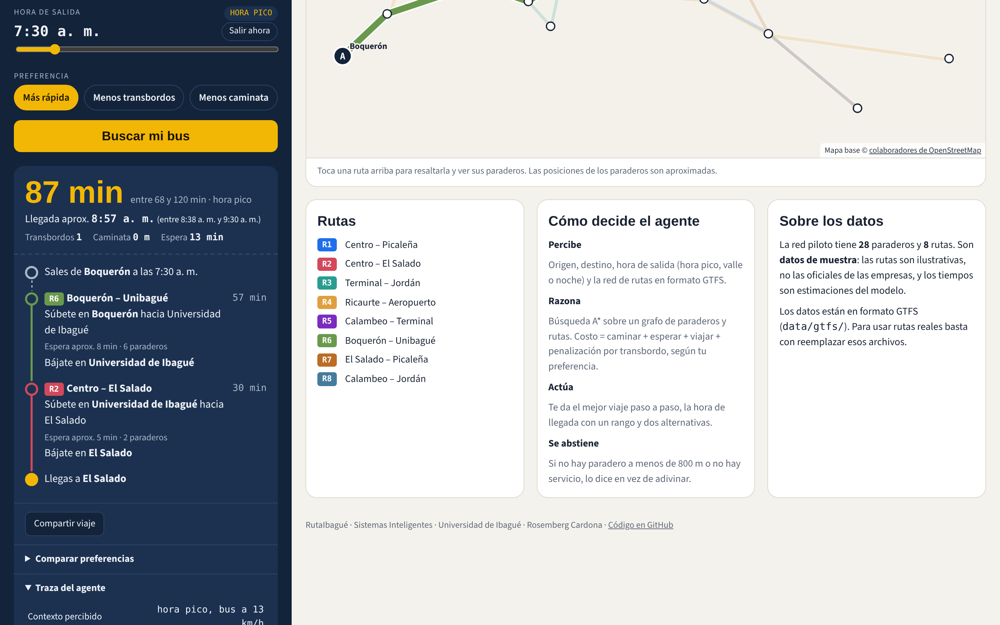

# RutaIbagué

**An intelligent agent that recommends which bus to take in Ibagué, Colombia.**
*Agente inteligente que recomienda qué bus tomar en Ibagué, Tolima.*

Course project, Intelligent Systems (Sistemas Inteligentes), Universidad de Ibagué.



- **Live app (Vercel):** https://rutasibague.vercel.app
- **Paper:** [`docs/paper/paper.pdf`](docs/paper/paper.pdf)
- **Dataset and promotional video (Google Drive):** https://drive.google.com/drive/folders/1dqNyADbWHi20WrNFY8ZSJ-veMudIHfCv
- **Dataset in this repository:** [`data/`](data/)

## What it does

The user gives an origin and a destination (a stop, a place, an address, their
current location or a point on the map), a departure time and a preference.
The agent:

1. **Perceives** the request and its context: the period of the day (peak,
   off-peak, night) sets the assumed bus speed, the waiting time and the
   uncertainty.
2. **Searches** a state graph of stops and route patterns with **A\***. The
   heuristic is the straight-line distance to the destination divided by the
   maximum speed, which never overestimates, so the trip found is optimal.
3. **Decides** with a utility function (generalized cost):
   `C = w·walk + wait + ride + k·transfers`, where `w` and `k` depend on the
   preference (*fastest*, *fewest transfers*, *least walking*).
4. **Acts**: step-by-step instructions, arrival time with a range, two
   alternatives and an agent trace (A\* vs Dijkstra).
5. **Abstains** when no stop is within 800 m of the origin or the destination,
   or when there is no service at that hour.

## Features

- Origin and destination by stop name, address search (OpenStreetMap
  Nominatim), current location, or tapping/clicking the map
- Street basemap (OpenStreetMap tiles), pan, zoom and pinch
- Departure time slider and "leave now"
- Three preferences, with a side-by-side comparison
- Arrival time and estimated range
- Route catalogue: highlight a route and see its stops and frequency
- Share a trip as a link
- Agent trace: perceived context, states expanded by A\* and Dijkstra, cost
- Installable web app (PWA) that keeps working offline (without street tiles
  and address search)
- Spanish interface, light and dark themes, phone and desktop layouts

## Project structure

```
index.html            app page
css/styles.css        styles
js/agent.js           the agent: context, A* search, utility, abstention
js/gtfs.js            GTFS loader (browser and Node.js)
js/map.js             SVG map with OpenStreetMap tiles, pan and zoom
js/app.js             user interface
js/data-bundle.js     GTFS embedded for offline / file:// use (generated)
data/gtfs/            pilot network in GTFS format (sample data)
tools/                scripts that generate the GTFS feed and the bundle
tests/                unit tests (node:test)
experiments/          experiments and figures reported in the paper
docs/paper/           paper (LaTeX source and PDF)
sw.js, manifest.webmanifest, icons/   installable web app
```

## Run it locally

No build step and no dependencies.

```bash
git clone https://github.com/rosembergcardona-cmd/rutasIbague.git
cd rutasIbague
python3 -m http.server 8000      # or: npx serve
# open http://localhost:8000
```

Opening `index.html` directly also works (it falls back to the embedded data).

## Tests and experiments

```bash
npm test             # 11 unit tests: optimality of A*, admissibility, preferences, abstention
npm run experiments  # writes experiments/results.json and docs/figures/
```

## Deploy on Vercel

1. In Vercel: **Add New → Project**, import this GitHub repository.
2. Framework preset **Other**, no build command, output directory `.` (root).
3. **Deploy**. Every push to `main` redeploys.

## Data and limitations

The network is **sample data**: no open dataset of Ibagué's bus routes was
found, so the stops are at approximate positions and the 8 routes are
illustrative. Speeds are assumptions to be calibrated with measured trips.
See [`data/README.md`](data/README.md). The results in the paper describe the
behaviour of the agent on this network, not real-world accuracy.

## Authors

- Rosemberg Cardona — Universidad de Ibagué — rosemberg.cardona@estudiantesunibague.edu.co
- Alexandra de la Cruz Puente (professor) — Universidad de Ibagué — alexandra.lacruz@unibague.edu.co

## License

MIT. Map data © OpenStreetMap contributors (ODbL).
